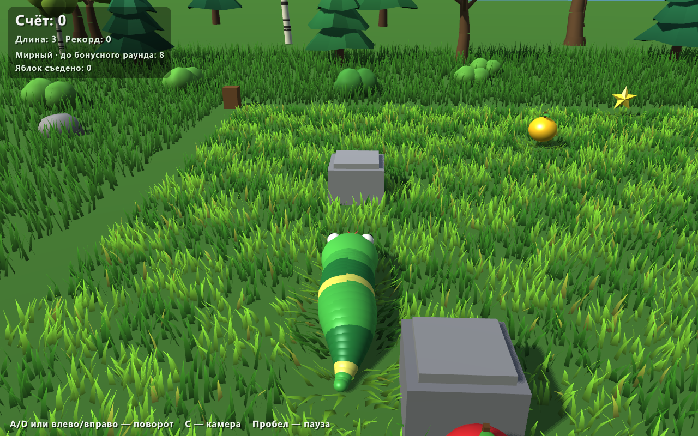
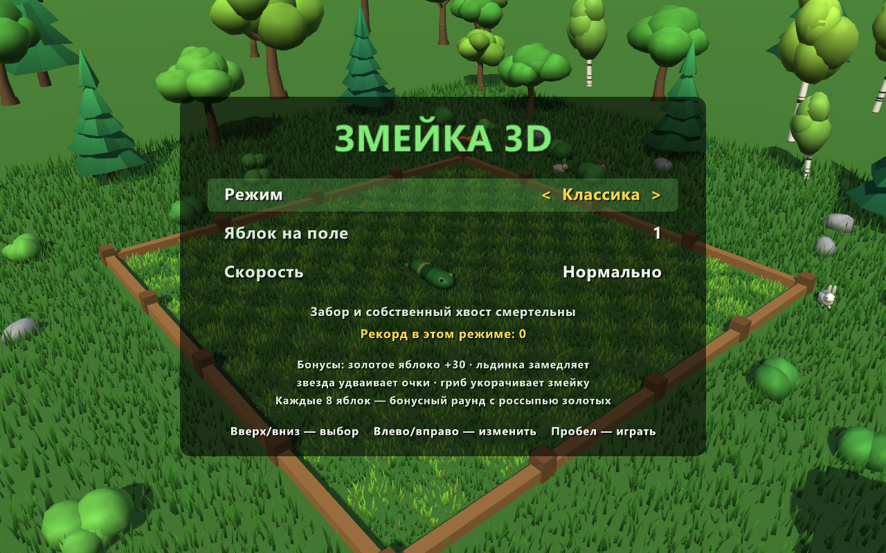

# Змейка 3D

Трёхмерная змейка на C++ и [raylib](https://www.raylib.com/). Змейка ползает по газону 16×16, вокруг — лес, кусты, кролики и лиса.





## Как запустить

**Windows, без установки чего-либо:** скачайте `snake3d-windows.zip` со страницы
[Releases](../../releases/latest), распакуйте и запустите `snake3d.exe`.

Нужна только видеокарта с поддержкой OpenGL 3.3 (любой компьютер примерно с 2012 года).
При первом запуске Windows может показать предупреждение SmartScreen, потому что программа не подписана:
нажмите «Подробнее» → «Выполнить в любом случае».

## Управление

| Клавиша | Действие |
| --- | --- |
| Стрелки / WASD | движение (вид сверху) |
| A/D или ←/→ | поворот влево и вправо (камера за змейкой) |
| C | переключить камеру |
| Пробел | старт и пауза |
| M | выйти в меню (на паузе или после проигрыша) |
| Esc | закрыть игру |

## Режимы

- **Классика** — забор и собственный хвост смертельны.
- **Без границ** — вышел за край поля, появился с другой стороны.
- **Стены** — после каждого яблока на поле вырастает камень.
- **Мирный** — умереть нельзя.

В меню также выбирается число яблок на поле (1, 3 или 5) и скорость. Лучший счёт запоминается отдельно для каждого режима.

## Бонусы

- **Золотое яблоко** — +30 очков.
- **Льдинка** — замедляет игру на 6 секунд.
- **Звезда** — удваивает очки на 8 секунд.
- **Гриб** — укорачивает змейку на 3 звена.

Бонус появляется раз в 8–13 секунд и исчезает через 7 секунд. Каждые 8 съеденных яблок начинается **бонусный раунд**: на поле на 8 секунд высыпаются 6 золотых яблок.

## Как это устроено

| Файл | Что в нём |
| --- | --- |
| `src/game.cpp` | Правила игры: движение, столкновения, режимы, бонусы. Не зависит от графики |
| `src/render.cpp` | Отрисовка: шейдеры освещения и травы, карта теней, змейка, животные |
| `src/meshgen.cpp` | Модели, построенные кодом: трава, деревья, кусты, камни |
| `src/main.cpp` | Окно, главный цикл, камера, меню и интерфейс |

Несколько приёмов, которые здесь использованы:

- **Плавное движение.** Логика игры шагает по клеткам, а на экране тело змейки рисуется вдоль сглаженной линии
  между прошлым и текущим положением.
- **Тени.** Сцена сначала рисуется «глазами солнца» в текстуру глубины (shadow map), затем при обычной отрисовке
  каждый пиксель проверяет, виден ли он солнцу.
- **Трава.** Около 50 тысяч травинок лежат в двух мешах. Ветер и приминание под змейкой считаются в вершинном шейдере.
- **Без внешних файлов.** Все модели создаются кодом при запуске, поэтому игра — это один `.exe`.

## Сборка из исходников

Нужны CMake 3.16+, компилятор C++17 и git. raylib скачивается автоматически при первой конфигурации.

```bash
cmake -S . -B build
cmake --build build --config Release
```

На Windows с Visual Studio готовая программа появится в `build/Release/snake3d.exe`.
Проект проверялся только на Windows. На Linux и macOS он должен собираться теми же командами, но надписи будут
на английском: русский шрифт берётся из системных шрифтов Windows.
